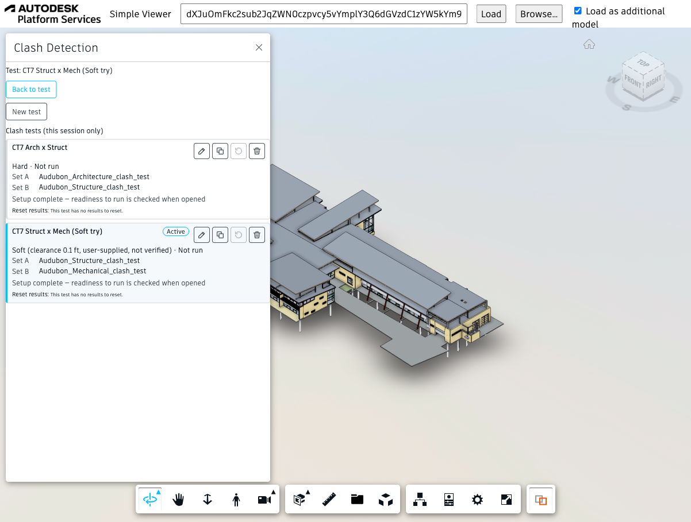
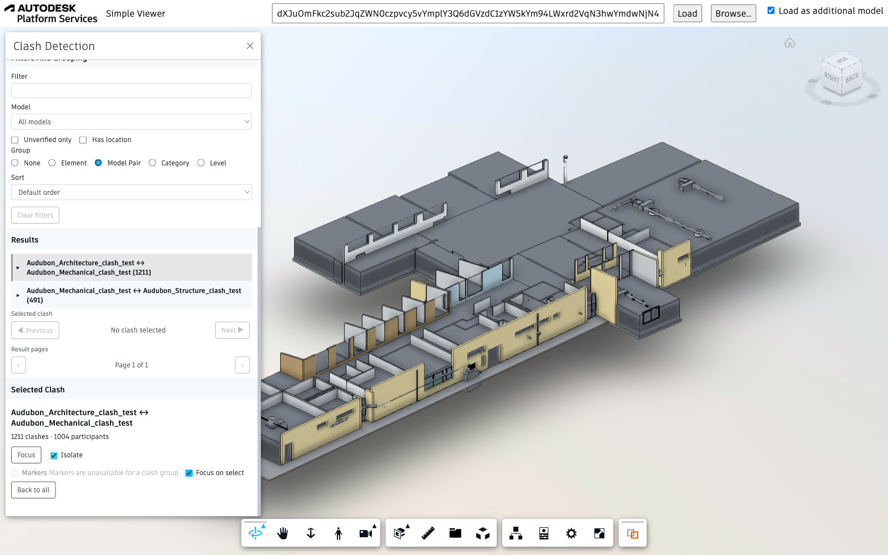
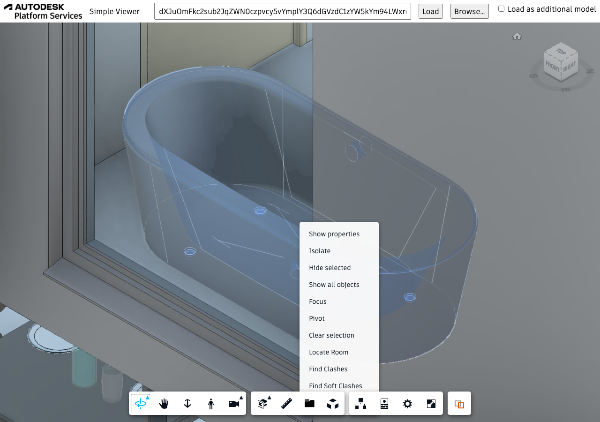
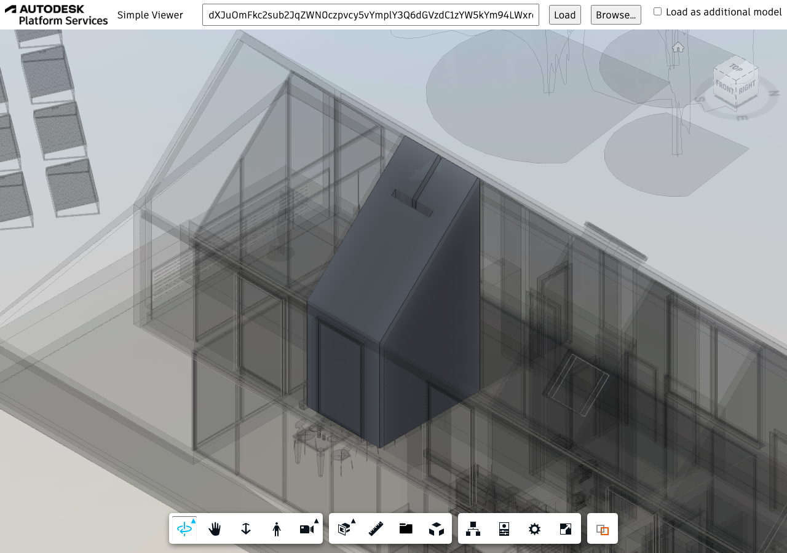
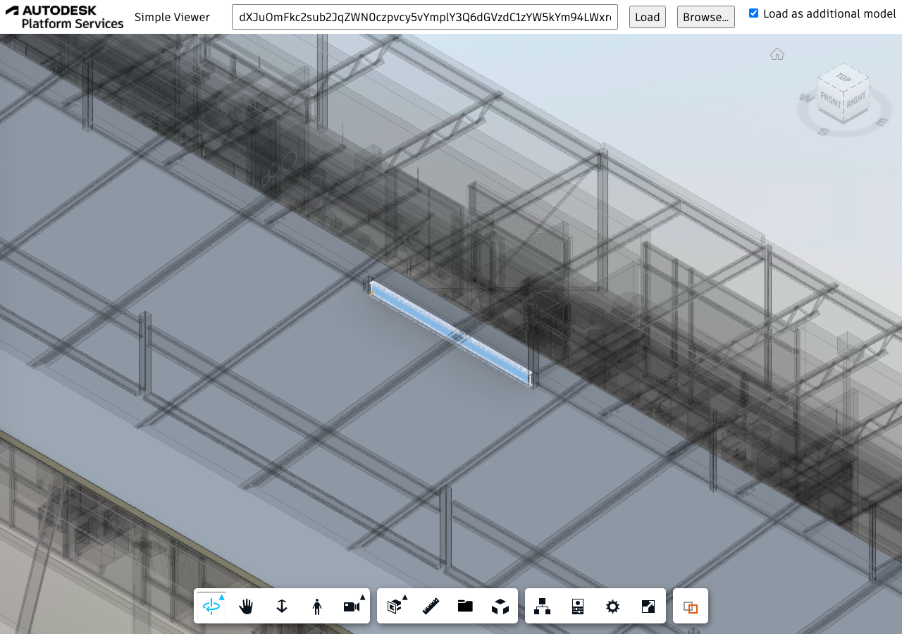
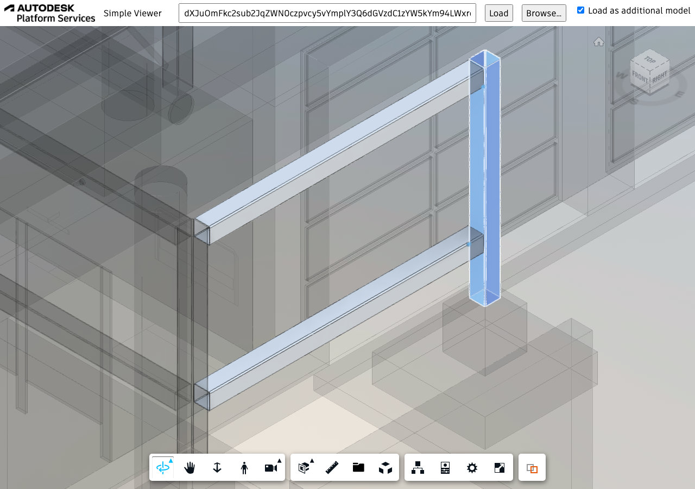

# APS Viewer Clash Detection (Node.js)


[](https://nodejs.org)
[](https://www.npmjs.com/)
[](https://opensource.org/licenses/MIT)

An [Autodesk Platform Services](https://aps.autodesk.com) Viewer sample for coordinating multi-model
projects in the browser. It demonstrates a Viewer-side clash-test workflow: define **Clash Tests**, run
**Clash Detection** across one or more loaded models, explore the **Clash Results**, and use **Find Room** to
locate the room that contains a selected element. Models are loaded as SVF2.

The sample started from the [Simple Viewer](https://tutorials.autodesk.io/tutorials/simple-viewer/) tutorial.

| Clash Tests | Clash Detection / Results |
| --- | --- |
|  |  |
| Create and manage clash tests | Browse grouped results, focus and isolate |

| Context menu | Find Room |
| --- | --- |
|  |  |
| Right-click a selected element | Locate Room — isolates the containing room |

| Find Clashes (hard) | Find Soft Clashes |
| --- | --- |
|  |  |
| Find Clashes — hard/overlap clashes for the selected element | Find Soft Clashes — soft/clearance clashes for the selected element |

## Features

### Clash Tests

Open the **Clash Detection** panel from the Viewer toolbar. The panel hosts a Clash Tests manager:

- Create, open, duplicate, delete and reset several tests in one session.
- Choose **Hard** (overlap) or **Soft** (clearance) mode. Soft clearance uses a distance you supply.
- Pick the models for **Set A** and **Set B**, use the current Viewer selection to narrow a set, or compare
  a set against itself.
- See each test's readiness, run it, and stop a run in progress.

Tests live in the browser session only; they are not saved across reloads.

### Clash Detection / Results

Each run produces a result set you can explore in the same panel:

- Run status, coverage and diagnostics summary, with a **Copy diagnostics** button.
- Individual clashes with **Previous / Next** navigation and paging.
- Filter by text or model, **Unverified only**, **Has location**, and sort order.
- **Group by** Element, Model Pair, Category or Level; select a group to present all its participants at once.
- **Focus**, **Isolate** and **Back to all** for a selected clash or group. **Markers** are available for individual clashes.
- Works across several loaded models (federated results).

### Context Menu Utilities

Select an element and right-click it to use these actions:

- **Locate Room** — finds the room(s) that contain the element (by default the model's "Revit Rooms"
  category), isolates them and fits the view. Requires a model that contains Revit room elements.
- **Find Clashes** — hard/overlap clashes for the selected element.
- **Find Soft Clashes** — soft/clearance clashes for the selected element.

Each action isolates its result in the Viewer. If a result may be incomplete, an alert says so.

## Libraries

- Collision library (`collision/`): see [`collision/README.md`](collision/README.md) for usage, supported
  query modes and known limitations. [`wwwroot/extensions/RoomLocatorExtension.js`](wwwroot/extensions/RoomLocatorExtension.js)
  is a reference integration.
- Federated clash-test engine (`clashtest/`): see [`clashtest/README.md`](clashtest/README.md).
- Clash panel (`clashpanel/`): see [`clashpanel/README.md`](clashpanel/README.md).

## Development

### Prerequisites

- [APS credentials](https://forge.autodesk.com/en/docs/oauth/v2/tutorials/create-app)
- [Node.js](https://nodejs.org) (Long Term Support version is recommended)
- Command-line terminal such as [PowerShell](https://learn.microsoft.com/en-us/powershell/scripting/overview)
or [bash](https://en.wikipedia.org/wiki/Bash_(Unix_shell)) (should already be available on your system)

> We recommend using [Visual Studio Code](https://code.visualstudio.com) which, among other benefits,
> provides an [integrated terminal](https://code.visualstudio.com/docs/terminal/basics) as well.

### Setup & Run

- Clone this repository: `git clone https://github.com/yiskang/aps-viewer-clash-detection`
- Go to the project folder: `cd aps-viewer-clash-detection`
- Install Node.js dependencies: `npm install`
- Open the project folder in a code editor of your choice
- Create a _.env_ file in the project folder, and populate it with the snippet below,
replacing `<client-id>` and `<client-secret>` with your APS Client ID and Client Secret:

```bash
APS_CLIENT_ID="<client-id>"
APS_CLIENT_SECRET="<client-secret>"
```

- Run the application, either from your code editor, or by running `npm start` in terminal
- Open http://localhost:8080

> When using [Visual Studio Code](https://code.visualstudio.com), you can run & debug
> the application by pressing `F5`.

## Troubleshooting

Please contact us via https://forge.autodesk.com/en/support/get-help.

## License

This sample is licensed under the terms of the [MIT License](http://opensource.org/licenses/MIT).
Please see the [LICENSE](LICENSE) file for more details.

## Written by

Eason Kang [in/eason-kang-b4398492/](https://www.linkedin.com/in/eason-kang-b4398492), [Developer Advocacy and Support Team](http://aps.autodesk.com)
